<div align="center">

<!-- Animated Header -->


<!-- Typing Animation -->
<a href="https://git.io/typing-svg">

</a>

<br/>


</div>

---

## 🧑‍💻 `whoami` — About Me

```text
Name       : Mathesh S
Education  : B.E. Cyber Security
College    : Sethu Institute of Technology
Primary    : Java Development
Currently  : Learning DSA & Backend Engineering
Interests  : Software Development | Cyber Security
Goal       : Become a skilled Software Developer
```

- 🎓 Cyber Security engineering student passionate about software development.
- ☕ Focused on Java, object-oriented programming, and backend development.
- 🧠 Practising Data Structures and Algorithms.
- 🌱 Learning Spring Boot, REST APIs, and database integration.
- 🛠️ Interested in building practical projects that solve real-world problems.
- 🚀 Continuously improving through coding and project development.

---

## 🖥️ Developer Terminal

<div align="center">
  
</div>

## 👨‍💻 My ASCII Portrait

<div align="center">
  
  <br />

  <i>Turning code into creativity.</i>
</div>

## ⚡ Tech Stack

### 💻 Programming Languages

<p>


</p>

### ⚙️ Backend Development

<p>


</p>

### 🗄️ Databases

<p>


</p>

### 🌐 Frontend

<p>


</p>

### 🛠️ Tools & Platforms

<p>


</p>

---

## 📊 GitHub Statistics

<div align="center">


</div>

---

## 💻 Developer Dashboard

<div align="center">

<a href="https://github.com/Mathesh3005">
  
</a>

</div>

## 🔥 Contribution Streak

<div align="center">


</div>

---

## 🐍 My Contribution Journey

<div align="center">
  <picture>
    <source
      media="(prefers-color-scheme: dark)"
      srcset="https://raw.githubusercontent.com/Mathesh3005/Mathesh3005/output/github-contribution-grid-snake-dark.svg"
    />
    <source
      media="(prefers-color-scheme: light)"
      srcset="https://raw.githubusercontent.com/Mathesh3005/Mathesh3005/output/github-contribution-grid-snake.svg"
    />
    
  </picture>
</div>

## 🗓️ Contribution Graph

<div align="center">


</div>

---

## 🚀 Featured Projects

<div align="center">

<a href="https://github.com/Mathesh3005">

</a>

</div>

> More projects coming soon! Visit my GitHub repositories to explore my work.

---

## 🎯 Current Goals

```text
[+] Strengthen Java fundamentals and OOP
[+] Practise Data Structures and Algorithms
[+] Build REST APIs using Spring Boot
[+] Improve SQL and database design skills
[+] Develop real-world software projects
[+] Prepare for software developer opportunities
```

---

## 🌐 Connect With Me

<div align="center">

<a href="https://github.com/Mathesh3005">

</a>

<a href="https://www.linkedin.com/in/mathesh-s-261222330">

</a>

</div>

---

<div align="center">

### 💡 `Keep Learning. Keep Building. Keep Growing.`


</div>
